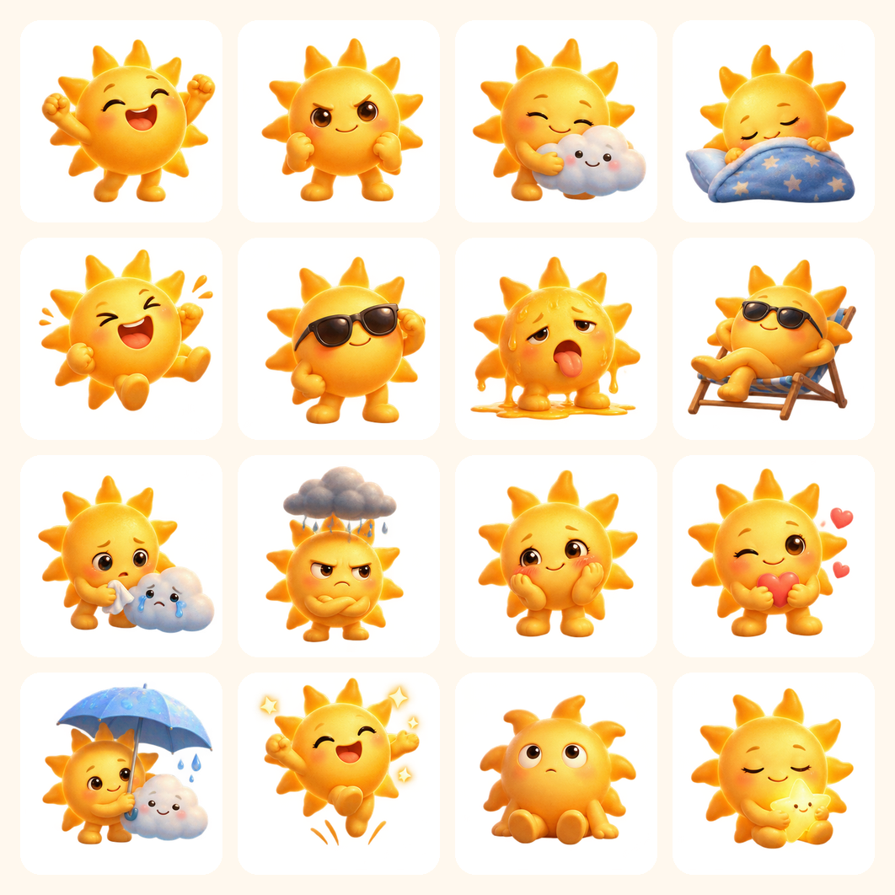
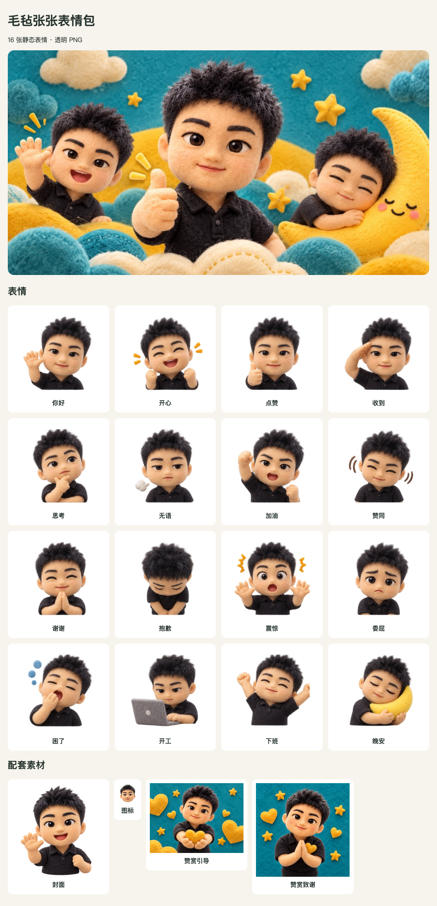
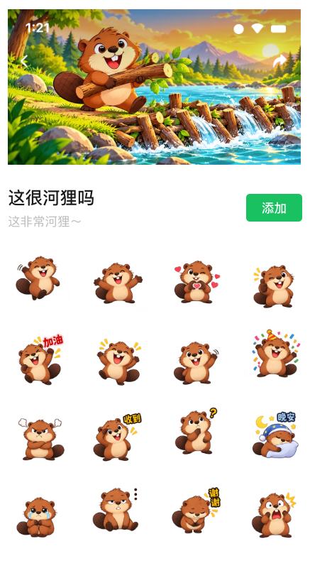
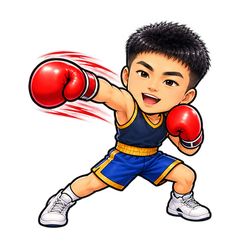
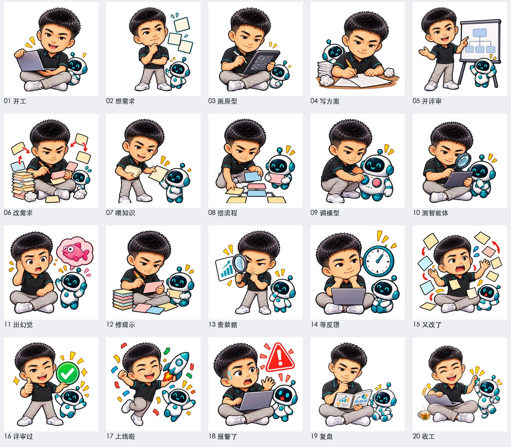
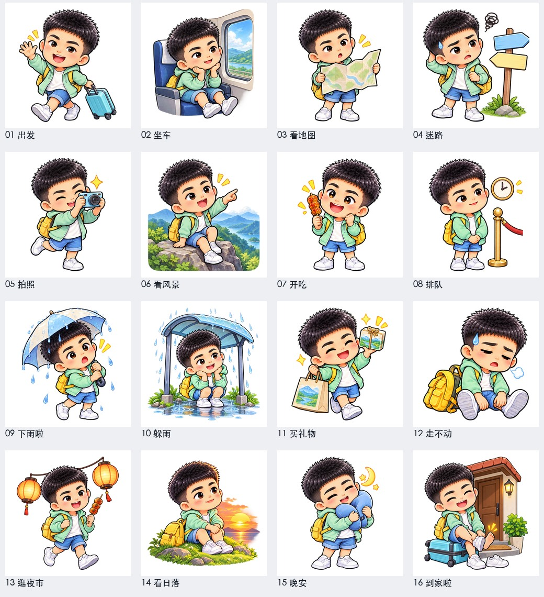
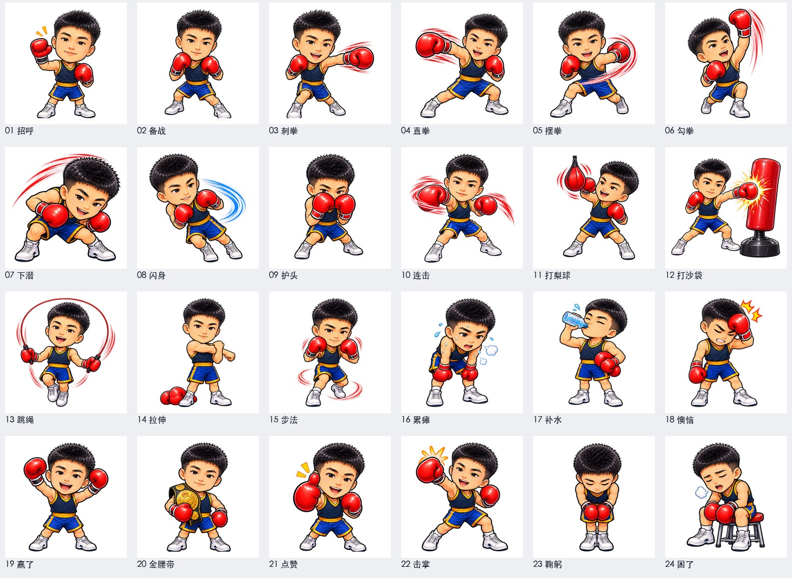
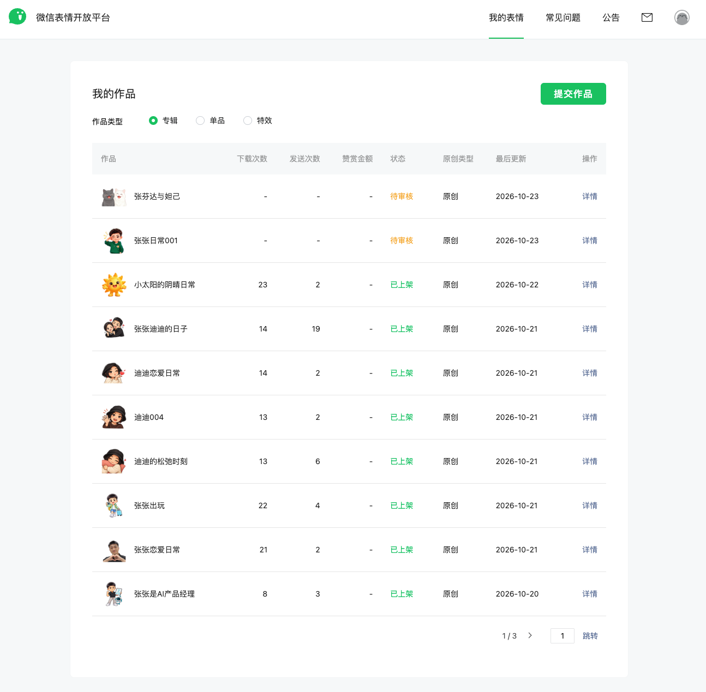
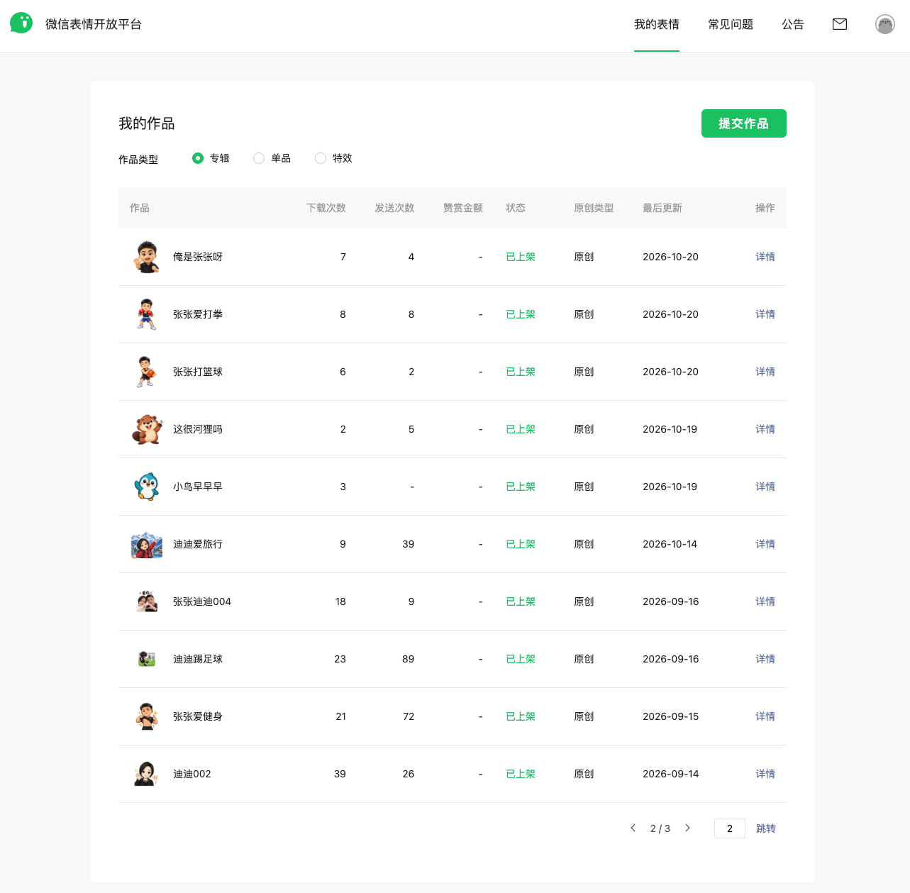
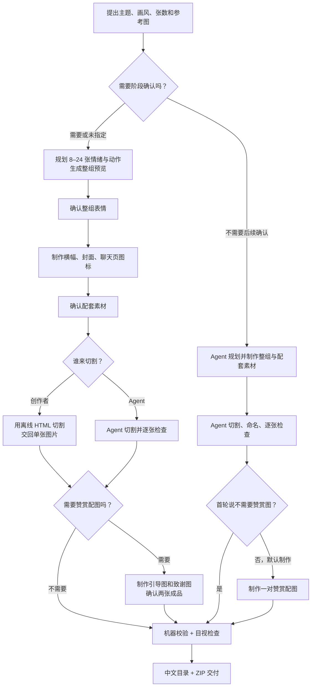

# weixin-sticker｜把一个角色，做成一整套微信表情

给一个角色或主题，制作一套可用于**微信表情开放平台投稿**的静态表情素材：8–24 张独立表情、详情页横幅、封面、聊天页图标，以及按需制作的赞赏配图。Skill 会引导出图、切割、检查尺寸与文件格式，并按中文目录整理、打包为 ZIP。

这是一个[开源的 Agent Skill](SKILL.md)，**不限于 Codex**。支持 Skills、图片生成和本地文件处理的 Agent 可以按各自方式安装使用。仓库提供流程、离线切割工具和校验脚本；图片生成能力由所用 Agent 提供，平台投稿由创作者完成。

**真实作品 · 完整交付 · 可核对的上架记录**

## 看看做出来的作品

以下展示真实成品和已上架案例。展示图用于说明效果；仓库不包含这些专辑的完整上传包或人物参考图。

### 阳光小太阳：同一角色的 16 种情绪与动作

从早安、加油到热化了、抱抱和晚安，一套表情覆盖日常聊天场景。下图是实际完成的整组预览；平台列表中可见《小太阳的阴晴日常》已上架。



## 安装

下载或克隆**整个仓库**，保留 `SKILL.md`、`scripts/`、`assets/` 和 `references/`；只复制 `SKILL.md` 会缺少切割与质检工具。

### Codex

```bash
mkdir -p "$HOME/.codex/skills"
git clone https://github.com/zxd-666/weixin-sticker.git "$HOME/.codex/skills/weixin-sticker"
python3 -m venv ~/.codex/skills/weixin-sticker/.venv
~/.codex/skills/weixin-sticker/.venv/bin/python -m pip install -r ~/.codex/skills/weixin-sticker/requirements.txt
```

也可以下载仓库 ZIP，解压后把 `weixin-sticker` 文件夹放进 `~/.codex/skills/`，再在新对话里使用。

### WorkBuddy、豆包工作等 Agent

这些产品有各自的技能入口，不使用 Codex 的目录路径。[WorkBuddy 官方文档](https://www.workbuddy.cn/docs/workbuddy/From-Beginner-to-Expert-Guide/Function-Description/Skills-Market)介绍了「添加技能 → 上传技能」导入本地技能包；[豆包开放平台](https://open.doubao.com/)也提供 Skill 能力。按所用产品的当前安装方式导入完整仓库，并确认运行环境具备图片生成、文件访问、Python 3 和 Pillow。跨 Agent 的实际执行效果取决于这些能力与权限配置。

## 开始制作

直接完成示例：

> 使用 weixin-sticker，按我提供的角色参考图制作 16 张微信静态表情。画风是毛毡卡通，场景包括你好、收到、无语、下班、晚安。不需要后续逐步确认，请完成整套素材、检查并打包交付。

如果希望逐阶段把关，把最后一句改成「需要逐步确认，先给我看整组表情」。涉及真人或特定角色时，请提供清晰的本人或有使用权的参考图，并说明必须保留的外貌特征。

交付目录示例：

```text
专辑目录/
├── 表情/            8–24 张 240×240 透明 PNG，逐张命名
├── 详情页横幅.png    750×400
├── 表情封面.png      240×240 透明 PNG
├── 聊天页图标.png    50×50 透明 PNG
├── 赞赏引导图.png    可选，750×560
└── 赞赏致谢图.png    可选，750×750
```

实际交付的横幅、赞赏图也可能是 JPG，见[完整素材规格与质检说明](references/wechat-album-spec.md)。ZIP 是整理和交付方式；**平台投稿时需解压，并把各文件上传到对应字段**。

## 更多作品

### 毛毡张张：一张图看完整套交付

16 张表情之外，预览图还展示了横幅、封面、聊天页图标和两张赞赏配图。



### 这很河狸吗：微信里的专辑页面

下图是微信表情页面截图，可看到专辑封面、表情排列和「添加」入口。



### 同一个张张，还能做不同主题

| 智能产品经理 · 20 张 | 周末出游 · 16 张 | 拳力出击 · 24 张 |
| :---: | :---: | :---: |
|  |  |  |
| 评审过 | 出发 | 直拳 |

<details>
<summary>展开看三套完整预览：20 张工作表达、16 张出游、24 张拳击</summary>

这些是制作时的整组质检预览，展示同一角色如何跨主题保持一致，并安排不同动作。

**智能产品经理 · 20 张**



**周末出游 · 16 张**



**拳力出击 · 24 张**



</details>

## 上架记录与审核说明

创作者反馈：**已上架的作品均一次过审**。下方是 2026-10-23 微信表情开放平台「我的作品」截图；前两页可见 **18 套已上架、2 套待审核**。待审核的两套不计入过审记录。截图能核对作品名称与当前状态，**不展示审核轮次**；「一次过审」来自创作者的投稿记录，也不代表新作品一定通过审核。

<details>
<summary>查看微信表情开放平台后台截图（第 1、2 页）</summary>

**第 1 页：**8 套已上架，2 套待审核。



**第 2 页：**10 套已上架。



</details>

## 从需求到交付：Skill 怎么工作



**逐步确认**适合想把关角色、表情和配套素材的人；每个确认点都可以提出修改。**直接完成**适合需求已明确、希望一次拿到成品的人；未指定张数时默认做 16 张，赞赏配图默认包含。两种模式都会检查裁切和文件规格。

## 它帮你完成什么

1. **规划整组表情**：围绕聊天场景安排不同情绪、动作与简短主题名，避免一套图只是重复换表情。
2. **生成投稿配套素材**：除了逐张表情，还制作横幅、封面和聊天页图标；赞赏引导图、致谢图可按需求成对生成。
3. **切割、处理与检查**：把整组图切成独立 PNG，处理尺寸和透明画布，检查数量、格式、尺寸、透明像素及文件体积。
4. **整理交付**：按中文文件名和目录组织素材，生成 ZIP。你拿到的是分好类的上传文件，而非仅有一张整组预览图。

可以选择**逐步确认**，在整组表情和辅助素材等阶段看图；也可以在开始时选择**直接完成**，由 Agent 继续完成切割、质检和打包。`assets/表情包切割.html` 可离线打开，支持网格切割、智能拆分、裁切调整和主题名批量解析。

机器检查覆盖数量、格式、尺寸、透明像素和体积；角色一致性、动作差异、边缘和画面质量还要目视检查。当前 Skill **只做静态表情**，不制作动态 GIF。表情画面默认无字；只有明确要求时才加字，主题名用于单图命名和清单。

## 微信表情开放平台：入口与投稿清单

- [微信表情开放平台](https://sticker.weixin.qq.com/)：注册、登录及提交作品入口。
- [注册常见问题](https://sticker.weixin.qq.com/cgi-bin/mmemoticon-bin/readtemplate?t=guide/index.html#/commonQuestions#commonQuestions_register)：账号注册与验证说明。
- [表情制作指引](https://sticker.weixin.qq.com/cgi-bin/mmemoticon-bin/readtemplate?t=guide/index.html#/makingSpecifications)：投稿素材和格式规则。

准备好交付包后：

1. 在电脑浏览器打开平台，按页面指引注册或登录艺术家账号。
2. 从投稿入口新建**表情专辑**，填写名称、简介、版权等页面要求的信息。
3. 解压 Skill 的 ZIP，将逐张表情、横幅、封面、聊天页图标分别上传到对应位置；按实际画面核对顺序、名称或含义描述。使用赞赏功能时，再上传对应配图。
4. 预览聊天尺寸、透明边缘和文字，确认无误后提交审核；后续在平台查看结果，并按反馈修改。

本 Skill 的目标尺寸与素材清单来自[仓库内的规格整理](references/wechat-album-spec.md)。平台规则和表单可能调整，**正式投稿以当时的上传页面与官方帮助中心为准**。脚本检查通过、已有案例过审，都不代表新作品会自动过审。

## 开发与验证

```bash
python3 -m pip install -r requirements.txt pytest
python3 -m pytest -q tests
node --test tests/test_cutter_group.mjs
```

Node.js 只用于运行切割工具测试；实际在浏览器使用切割 HTML 不需要 Node.js。

## 许可证

[MIT](LICENSE) © 2026 [zxd-666](https://github.com/zxd-666)。

## 联系

张张实验室 · [GitHub](https://github.com/zxd-666) · [小红书](https://xhslink.cn/o/7DSli2Fl3Vb)
